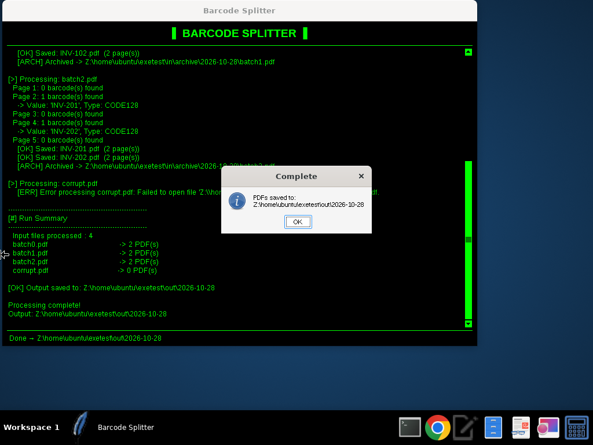

# 📦 Invoice Number Barcode Splitter

> Split multi-page PDFs into one PDF per barcode value — with a classic black-and-green terminal look.



## ⬇️ Download

Grab the ready-to-run **`barcode_splitter.exe`** from the [Releases page](https://github.com/entropytwo-ai/invoice-number-barcode-splitter/releases/latest).
It is a single self-contained file: Python, the ZBar DLLs and the Visual C++ runtimes are bundled inside, so nothing else needs to be installed. Just double-click it.

> Windows SmartScreen may warn about an unsigned app the first time — choose **More info → Run anyway**.

---

## Overview

**Barcode Splitter** is a Windows desktop tool that processes every PDF in an input folder, detects barcodes on each page, and splits the pages into separate PDFs grouped by barcode value (e.g. one PDF per invoice number).

Processed input files are archived into dated folders, and archives older than **31 days** are cleaned up automatically.

---

## ✨ Features

- **Barcode-based splitting** of multi-page PDFs using `pyzbar` + `PyMuPDF`
- **Supported symbologies:** `CODE128`, `EAN13`, `CODE39`, `I25`
- **Smart page grouping** — pages after a barcode page belong to that barcode until a new one appears
- **Daily archiving** of processed PDFs into `archive/YYYY-MM-DD/`
- **Automatic retention cleanup** — archive folders older than 31 days are deleted
- **Remembers your folders** — last input/output paths stored in `settings.json`
- **🟩 Terminal-style theme** — black background, bright-green `Courier New` text, green separators
- **Scrollable live log** with a proper scrollbar
- **Status bar** showing the current state (Ready / Processing / Done / Error)
- **Per-file error isolation** — one corrupt PDF no longer aborts the whole batch
- **Thread-safe GUI** — processing runs in a background thread; all UI updates are marshalled to the main thread
- **Run summary** with per-file output counts and page counts for every saved PDF
- Packaged as a **standalone Windows executable** with PyInstaller

---

## 🖥 Requirements

| Item | Version |
|------|---------|
| OS | Windows 10 or later (64-bit) |
| Python | **3.10.x** (see notes) |

## 📚 Dependencies

Install with:

```bash
pip install -r requirements.txt
```

`requirements.txt`:

```
pyzbar==0.1.9
pymupdf
Pillow
pyinstaller
```

## 🔌 DLL Requirements

`pyzbar` needs the ZBar native libraries on Windows. Both DLLs are included in this repo and must sit **next to the script / executable**:

- `libzbar-64.dll`
- `libiconv.dll`

Source: <https://github.com/NaturalHistoryMuseum/barcode-reader-dlls/releases>

---

## ⚙️ Configuration

`settings.json` is created automatically in the working directory and stores the last used folders:

```json
{
  "last_input": "C:\\Scans\\Incoming",
  "last_output": "C:\\Scans\\Split"
}
```

If the file is missing or malformed, the app falls back to defaults instead of crashing.

Tunable constants at the top of `barcode_splitter.py`:

| Constant | Default | Purpose |
|----------|---------|---------|
| `DPI` | `400` | Render resolution used for barcode detection |
| `ALLOWED_BARCODE_TYPES` | `CODE128, EAN13, CODE39, I25` | Accepted symbologies |
| `RETENTION_DAYS` | `31` | Archive retention period |
| `BG_COLOR` / `FG_COLOR` | `#000000` / `#00FF00` | Theme colours |
| `FONT_FACE` / `FONT_SIZE` | `Courier New` / `10` | Log font |

---

## 🚀 Usage

1. Run `barcode_splitter.exe` (or `python barcode_splitter.py`).
2. Choose whether to reuse the last **input** folder, or pick a new one.
3. Do the same for the **output** folder.
4. Watch the green-on-black log as each PDF is processed.
5. When finished, a dialog shows where the output was saved.

**Output layout**

```
<output>/
└── 2026-10-28/            # _1, _2 … appended if run more than once a day
    ├── INV-10001.pdf
    └── INV-10002.pdf

<input>/
└── archive/
    └── 2026-10-28/
        └── original_scan.pdf
```

> Pages appearing **before the first barcode** in a PDF are intentionally skipped.

---

## 📦 Building the .exe

**On Windows** (Python 3.10.x, 64-bit) — just run:

```bat
build.bat
```

which installs `requirements.txt` and runs:

```bat
pyinstaller --clean --noconfirm --onefile --noconsole --name barcode_splitter --version-file version_info.txt ^
  --add-binary "libzbar-64.dll;." --add-binary "libiconv.dll;." ^
  --add-binary "redist\MSVCR120.dll;." --add-binary "redist\MSVCP140.dll;." barcode_splitter.py
```

**On Linux** (cross-build with Wine + Windows Python 3.10): `./build_exe_wine.sh`

The executable is written to `dist/barcode_splitter.exe`. Built binaries are git-ignored; releases are published on the Releases page.

**Why `redist/`?** `libzbar-64.dll` depends on the Visual C++ 2013 runtime (`MSVCR120.dll`) and PyMuPDF depends on `MSVCP140.dll`. Bundling these Microsoft-signed redistributable DLLs means the exe works on PCs that don't have the VC++ redistributables installed.

---

## 🆕 What's New (v2)

**Theming / UI**
- Black background, bright-green Courier New text throughout the window
- Header banner, green separator lines and bottom status bar
- Added a scrollbar to the log area; larger, resizable window

**Bug fixes**
- Removed an unreachable `elif` branch in page accumulation
- Message boxes and log writes are no longer called from the worker thread (Tk is not thread-safe)
- The completion dialog no longer disappears instantly — the app closes after you dismiss it
- One bad PDF no longer kills the batch (per-file `try/except`)
- PDF handles are always closed, even on error, so archiving works on Windows
- `load_config` survives malformed `settings.json`; `save_config` handles write errors
- Graceful message when the input folder has no PDFs
- "Use last folder?" is only asked when a valid last folder exists

**Packaging (v2.0.0 release)**
- Prebuilt `barcode_splitter.exe` published on GitHub Releases
- VC++ runtimes (`MSVCR120.dll`, `MSVCP140.dll`) bundled so the exe runs on clean PCs
- Windows version info embedded (Explorer → Properties → Details)
- One-click `build.bat` and Linux `build_exe_wine.sh` build scripts
- Green-themed scrollbar (native Windows scrollbars ignore colours, so a styled ttk scrollbar is used)
- Log uses ASCII tags (`[OK]`, `[ERR]`, `[ARCH]` …) instead of emoji, which Tk on Windows can't always draw
- Switched from the deprecated `import fitz` to `import pymupdf`

**Code quality**
- Type annotations throughout
- Extracted helpers: `_process_single_pdf()`, `_unique_dest_folder()`, `_ask_folder()`
- PDFs processed in sorted, deterministic order
- Theme constants at the top of the file
- Readable `settings.json` (`indent=2`) and a nicer run summary
- Added `requirements.txt` and `.gitignore`

---

## ⚠️ Important Notes

- **Do NOT rename** `libzbar-64.dll` to `zbar.dll` — `pyzbar` looks for the exact name.
- **Use Python 3.10.x.** Python 3.13+ has known `pyzbar` compatibility issues.
- Processing runs in a **background thread**; every GUI update is scheduled on the main thread via `root.after()`.

---

## 🛠 Troubleshooting

| Problem | Fix |
|---------|-----|
| `Unable to find zbar shared library` / missing `MSVCR120.dll` | When running from source, install Microsoft's *Visual C++ Redistributable for Visual Studio 2013 (x64)* or copy `redist\MSVCR120.dll` next to the script. (The prebuilt exe already bundles it.) |
| `ImportError: Unable to find zbar shared library` | Make sure `libzbar-64.dll` and `libiconv.dll` are beside the script/exe and not renamed. |
| No barcodes detected | Check scan quality; try raising `DPI`; confirm the symbology is in `ALLOWED_BARCODE_TYPES`. |
| A file shows `0 PDF(s)` in the summary | No valid barcode was found, or the file errored — check the log line marked `[ERR]`. |
| `Archive failed` warning | The file is open in another program; close it and re-run. |
| Settings not remembered | Ensure the working directory is writable so `settings.json` can be saved. |
| pyzbar errors on new Python | Downgrade to Python 3.10.x. |
